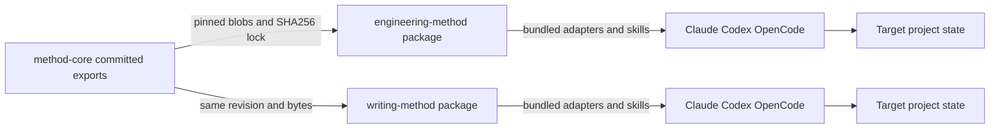

# EM-018 ownership and installation

Purpose: Which repository owns common behavior, and can each method execute without a sibling checkout? Requirements: FR-002 through FR-006; IC-001 through IC-004. Sources: EM-018 plan, existing skill links, `engineering_method/cli.py`, `scripts/package_plugin.py`. Notation: Mermaid flowchart component view. Verification date: 2026-11-13. Mode: design; reconcile after integration.

Core has no dependency on either consumer. Consumers have no runtime dependency on one another or a network service. A sync operation validates the entire proposed write set before applying changes; failed writes restore the old managed files and lock. Runtime state belongs to target projects, never to the plugin installation. Gemini is absent until separately verified. Mermaid source is semantically inspected; no render is claimed.
